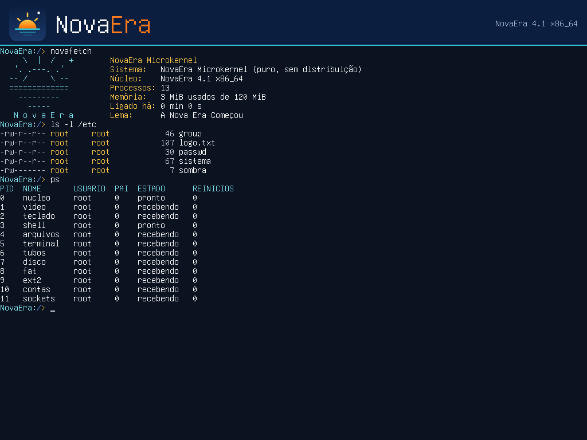

# 16. A tela gráfica

Até aqui, a tela do NovaEra era de **texto**: 80 colunas por 25 linhas, e
quem desenhava cada letra era a própria placa de vídeo. Agora ela pode
ser **gráfica**: 1024 × 768 pontos, cada um com a sua cor (16 milhões de
cores possíveis), e quem desenha tudo, letra por letra, é o NovaEra.

## Como ligar em modo gráfico

| Onde | Como |
|---|---|
| no computador (QEMU numa janela) | `bash run.sh grafico` |
| no celular (Termux) | `bash run.sh vnc` e um app de VNC em `localhost:5901` |
| pela ISO ou pelo disco | no menu do GRUB, a opção "modo gráfico" |

O modo texto continua sendo o padrão: o QEMU do Termux mostra a tela em
texto (`-display curses`) e não consegue mostrar gráficos.

**O VNC no celular**, passo a passo:

1. instale um app de VNC (bVNC ou RealVNC Viewer, grátis na Play Store);
2. no Termux, rode `bash run.sh vnc` e deixe aberto;
3. no app, crie uma conexão para `localhost`, porta `5901`, e conecte.

## O que é um framebuffer

A tela gráfica é só um **pedaço de memória** dentro da placa de vídeo: 4
bytes para cada ponto (azul, verde, vermelho e um que sobra), linha por
linha. São 1024 × 768 × 4 = 3 MiB. O que você escreve ali aparece na tela,
na hora. Esse pedaço se chama **framebuffer**.

Para escrever a letra "A", o NovaEra olha o desenho dela na **fonte** (16
linhas de 8 pontinhos, ligados ou desligados) e pinta os pontos ligados
com a cor da letra e os outros com a cor do fundo. A fonte do terminal é
a "Fixed", das fontes do X11, de domínio público, com os acentos do
português.

A logo no topo (o sol nascendo) também é desenhada ponto por ponto, a
partir das mesmas formas do arquivo `arte/logo.svg`: um quadrado de
cantos redondos, um meio círculo, os raios, as linhas do horizonte. Cada
ponto é a média de 16 amostras, e por isso as bordas ficam suaves.

## Como funciona no NovaEra

- A placa usada é a **BGA**, que o QEMU, o VirtualBox e o Bochs oferecem:
  o servidor de vídeo escolhe a resolução escrevendo em duas portas
  (`0x1CE` e `0x1CF`) e acha o endereço do framebuffer perguntando ao
  **barramento PCI** (a lista dos dispositivos do computador).
- O **núcleo** só ganhou uma coisa: deixar um driver colocar a memória
  de um dispositivo na memória dele (`SYS_MAPEAR_FISICO`). E nunca a
  memória RAM: assim, nem um driver consegue ler a memória dos outros
  programas.
- Desenhar é trabalho do **servidor de vídeo** (PID 1), no anel 3, como
  sempre. Os programas não mudaram nada: continuam mandando texto para o
  terminal, que manda para o servidor de vídeo.

Num PC de verdade sem a BGA, falta ainda usar o framebuffer que o GRUB
prepara (o VBE); por enquanto, o NovaEra fica em modo texto.
