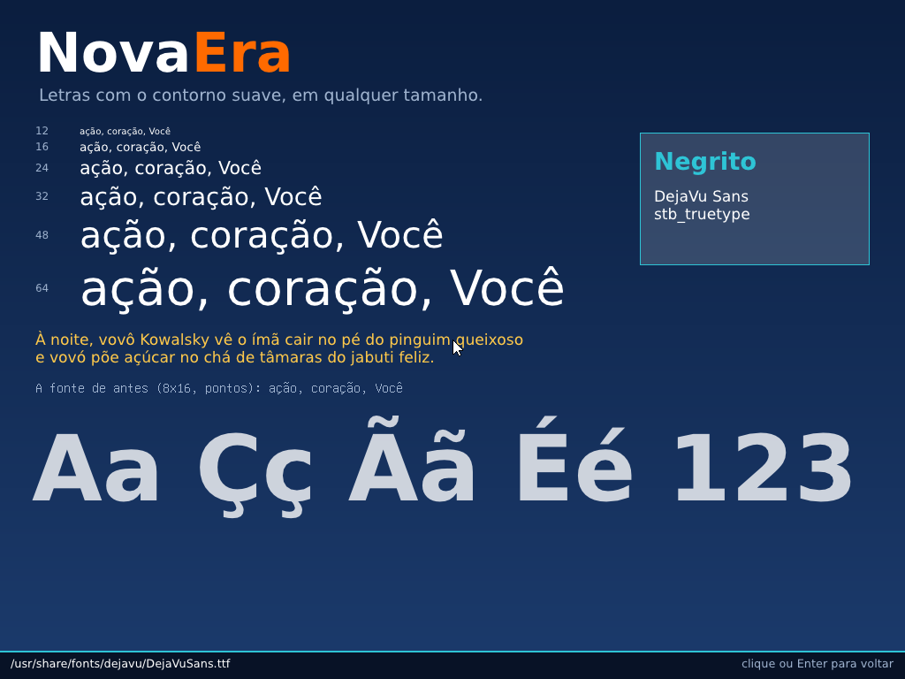

# 19. Letras bonitas

A fonte do terminal (capítulo 16) é feita de **pontos**: cada letra é um
quadradinho de 8 × 16, com cada ponto aceso ou apagado. Ela não cresce
bem: dobrada, fica "quadriculada". Agora o NovaEra tem também letras de
**contorno**, como as do Linux, do Windows e do celular: elas ficam bonitas
em qualquer tamanho, com a borda suave.



## Na prática

Ligue em modo gráfico (`bash run.sh grafico`, ou `bash run.sh vnc` no
celular) e rode:

```
letras
```

A tela mostra a fonte **DejaVu Sans** em vários tamanhos, de 12 a 120
pontos, com acentos, e o negrito. Clique (ou aperte Enter) para voltar.

## Contorno, não pontos

Uma fonte **TrueType** (o arquivo `.ttf`) guarda cada letra como um
**desenho de curvas**: "comece aqui, faça uma curva até ali, uma reta até
lá...". Para escrever, o computador **pinta** o desenho numa grade de
pontos, no tamanho pedido. O mesmo arquivo serve para letras de 12 ou de 120
pontos.

A borda suave vem de um detalhe: um ponto da beirada da letra fica só **em
parte** dentro do desenho. Em vez de escolher entre aceso e apagado, ele
recebe uma cor no meio do caminho, proporcional ao quanto ficou dentro (o
**anti-aliasing**). De longe, o olho vê uma curva lisa.

```
pontos (8x16)         contorno (suave)
  ##                     .#%.
 #  #                   %+  +%
 ####                   %####%
 #  #                   %+  +%
```

O NovaEra faz isso com a transparência do capítulo 18: a cobertura do ponto
(0 a 255) vira o "A" da cor, e o `gr_ponto` mistura com o que está embaixo.

## A stb_truetype

Quem lê o `.ttf` e pinta as curvas é a **stb_truetype**, do mesmo Sean
Barrett do stb_image: um arquivo em C, de domínio público, em
`libc/src/stb/stb_truetype.h`, do jeito que veio. A `fonte.c` liga ela à
libc e guarda cada letra pintada (o **cache**): pintar custa, e um texto
repete muito as mesmas letras.

Ela trouxe uma novidade para a libc: a `math.h` (raiz quadrada, seno,
cosseno, potência...), que a stb_truetype usa. Cada função é feita em C,
com as contas de sempre: separar o número em mantissa e expoente e somar
uma série curta (Taylor, Newton). As que têm resposta exata (`floor`,
`ceil`, `fabs`) dão exatamente o mesmo número que no Linux.

### Dois detalhes que deixam o texto bonito

- **Kerning:** algumas duplas de letras ficam melhores mais juntas, como
  "AV" e "Wa". A fonte tem uma tabela dessas duplas, e a stb_truetype
  consulta ela a cada letra.
- **Quartos de ponto:** a posição de cada letra é um número quebrado (a
  letra "a" de 20 pontos tem 10,5 pontos de largura). Em vez de arredondar
  tudo para o ponto inteiro (e as letras ficarem com espaços tortos), a
  letra é pintada já deslocada em 1/4, 2/4 ou 3/4 de ponto.

## Para os programas

```c
#include <grafico.h>

gr_fonte_t *f = gr_fonte_abrir(GR_FONTE_NORMAL);     /* ou GR_FONTE_NEGRITO */
int l = gr_fonte_texto(tela, f, 40, 40, "Olá, Você!", 48, GR_BRANCO);
```

| Função | O que faz |
|---|---|
| `gr_fonte_abrir` | abre um arquivo `.ttf` (NULL se não deu) |
| `gr_fonte_texto` | escreve; (x, y) é o canto de cima da linha; devolve a largura |
| `gr_fonte_largura` | mede um texto sem desenhar (para centralizar) |
| `gr_fonte_altura` | a altura de uma linha (para pular linha) |
| `gr_fonte_fechar` | libera a fonte |

O tamanho é a altura das letras em pontos da tela. O `\n` no texto pula
linha. As fontes ficam em `/usr/share/fonts/dejavu/`; qualquer outro `.ttf`
também serve (`letras outra.ttf`).

## As fontes DejaVu

A DejaVu é uma família de fontes livre, feita a partir da Bitstream Vera, e
é a fonte padrão de muitas distribuições Linux. Ela tem milhares de letras:
os acentos do português, o grego, o cirílico, setas, símbolos (€, ©, ½).
Os arquivos estão em `letras/` no código do NovaEra, sem nenhuma mudança,
com a licença deles.

## Como saber se está certo

Como no capítulo 18, o `testegrafico` escreve um texto em três tamanhos e
calcula a impressão digital dos pontos. No NovaEra e no Linux, o número é o
mesmo:

```
testegrafico -fonte /usr/share/fonts/dejavu/DejaVuSans.ttf
```

```
cena 320x240: 5540b5b8
DejaVuSans.ttf: texto 6071698b, largura 275, altura 32
```

Na Etapa 5, os títulos das janelas vão ser escritos com estas letras.
