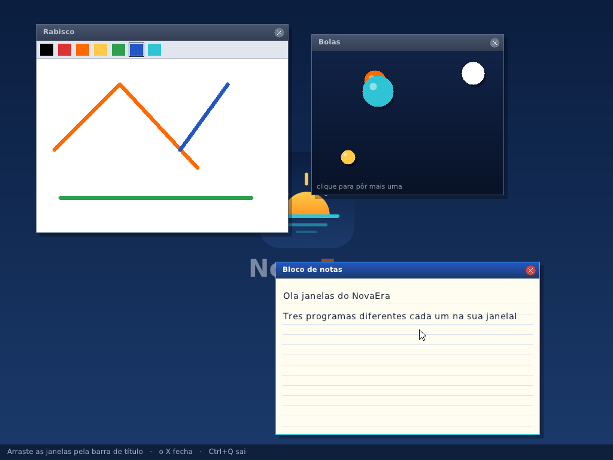

# 20. O servidor de janelas

Até aqui, um programa gráfico pegava a tela **inteira** emprestada (o `ver`,
o `letras`). Agora vários programas dividem a tela, cada um na sua
**janela**: dá para arrastar, pôr uma na frente da outra e fechar.



## Na prática

Ligue em modo gráfico (`bash run.sh grafico`, ou `bash run.sh vnc` no
celular) e rode:

```
janelas
```

Aparecem três programas, cada um na sua janela:

| Programa | O que faz |
|---|---|
| `rabisco` | desenhar com o mouse; clique numa cor para trocar; o botão direito limpa |
| `bloco` | um bloco de notas: o que você digita aparece nele |
| `bolas` | bolas quicando, sozinhas; clique para pôr mais uma |

- **Arrastar:** segure na barra de título (a faixa de cima) e mexa.
- **Trazer para a frente:** clique em qualquer lugar da janela.
- **Fechar:** o X vermelho. Só aquela janela fecha; as outras continuam.
- **O teclado** vai para a janela da frente (a da barra azul).
- **Ctrl+Q** fecha tudo e volta ao terminal.

Para abrir outros programas: `janelas rabisco rabisco` (dois rabiscos), ou
`janelas -` (nenhum).

## Quem desenha o quê

A ideia é a mesma do **Wayland**, que os Linux novos usam:

- **Cada programa desenha a sua janela sozinho**, numa memória
  compartilhada (Fase 4, Etapa 7), com a biblioteca do capítulo 18.
- **O servidor de janelas só monta a tela:** pinta o fundo e, por cima,
  cada janela, da que está mais atrás para a da frente, com a moldura (a
  barra de título, o X e a sombra). Ele nunca desenha **dentro** de uma
  janela.

```
  rabisco ──┐  memória compartilhada (os pontos da janela)
  bloco   ──┼─────────────────────────────►  janelas  ──►  vídeo  ──►  tela
  bolas   ──┘  socket /tmp/janelas (os pedidos e os eventos)
```

Os dois conversam por um **socket local** (Fase 4, Etapa 8), com
mensagens de tamanho fixo:

| Quem manda | Mensagem | O que diz |
|---|---|---|
| programa | `JN_CRIAR` | "quero uma janela deste tamanho, com este título; a memória dela se chama assim" |
| programa | `JN_MOSTRAR` | "mudei este pedaço da janela" |
| servidor | `JN_MOUSE` | "clicaram (ou arrastaram) em tal ponto da sua janela" |
| servidor | `JN_TECLA` | "digitaram esta letra (você está na frente)" |
| servidor | `JN_FECHAR` | "clicaram no seu X" |

A posição do clique já chega **dentro** da janela: (0, 0) é o canto dela,
não o da tela. O programa não sabe (nem precisa saber) onde a janela está.

## Se um programa morre

O servidor tem uma thread esperando cada programa no socket. Se o programa
termina (ou falha), o socket fecha, e a thread tira a janela dele da tela.
As outras janelas nem ficam sabendo. É o mesmo jeito de pensar do
microkernel: um pedaço que quebra não derruba os outros.

## Por dentro do servidor

O `janelas` tem várias **threads** (Fase 4, Etapa 6):

- uma espera o **mouse** (`gr_mouse`): decide se é arrastar, trazer para a
  frente, fechar ou um clique para o programa;
- uma espera o **teclado**: o terminal fica no modo "cru" (`TERM_CRU`),
  em que cada tecla chega na hora, sem esperar o Enter;
- uma **aceita** os programas novos, e uma para **cada programa**;
- a **principal desenha**.

As outras não desenham: marcam "este pedaço da tela mudou" e acordam a
principal. Arrastar uma janela gera dezenas de movimentos por segundo; se
a tela ainda não foi redesenhada, os pedaços se juntam num desenho só.

Para redesenhar um pedaço, o servidor usa um truque: uma **imagem de
mentira** que aponta para o meio da tela, com o tamanho do pedaço. Tudo que
se desenha nela fica cortado ali dentro, sem nenhuma conta a mais.

## Para os programas: janela.h

```c
#include <janela.h>

int main(void)
{
    jn_janela_t *j = jn_abrir("Olá", 300, 200);
    gr_preencher(j->im, 0, 0, 300, 200, GR_AMARELO);
    jn_mostrar_tudo(j);
    jn_evento_t e;
    while (jn_esperar(j, &e) && e.tipo != JN_FECHAR) {
        if (e.tipo == JN_MOUSE && e.evento == JN_APERTOU) {
            gr_disco(j->im, e.x, e.y, 10, GR_AZUL);
            jn_mostrar(j, e.x - 10, e.y - 10, 21, 21);
        }
    }
    jn_fechar(j);
    return 0;
}
```

`j->im` é uma imagem como qualquer outra do capítulo 18: tudo da
`grafico.h` (e as letras do capítulo 19) funciona nela. Na Etapa 6, a
`janela.h` ganha botões, caixas de texto e o resto que um programa de
verdade precisa.
