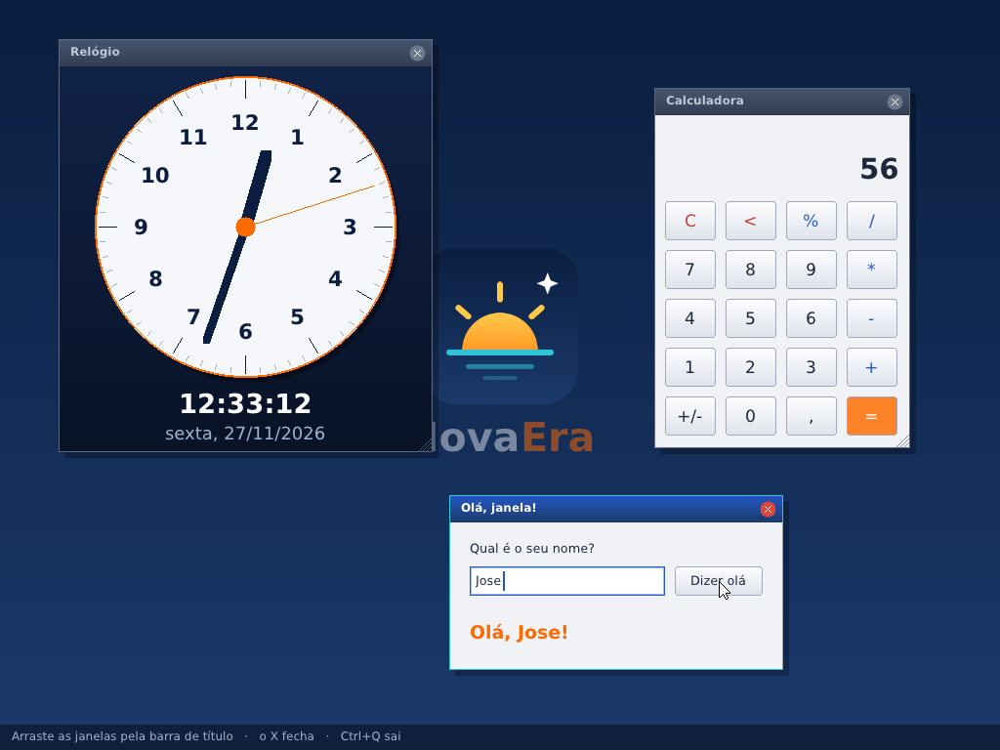

# 21. A biblioteca das janelas

No capítulo 20, cada programa desenhava a sua janela ponto a ponto. Para
um programa de verdade (uma calculadora, um formulário), isso dá muito
trabalho: todo botão teria de ser desenhado e conferido "o clique foi
dentro dele?". A `janela.h` agora traz **controles prontos**: rótulos,
botões e caixas de texto. E as janelas podem **mudar de tamanho**.



## Na prática

No modo gráfico (`bash run.sh vnc` no celular), rode:

```
janelas
```

Abrem o **relógio**, a **calculadora** e o **bloco de notas**.

- A calculadora funciona com o mouse ou com o teclado (números, `+ - * /`,
  Enter para o `=`, Esc para limpar).
- O relógio mostra a hora do computador, no fuso do `/etc/fuso`.
- **Mudar o tamanho:** puxe o canto de baixo, à direita (onde há três
  risquinhos). Um contorno mostra o tamanho novo; ao soltar, o programa
  se redesenha: o relógio cresce, os botões da calculadora se espalham.

## O primeiro programa de janela

O exemplo `ola.c` pergunta o seu nome e diz olá. Compile **dentro do
NovaEra** e rode:

```
cproc -o /tmp/ola /usr/share/nefs/exemplos/janelas/ola.c
janelas /tmp/ola
```

O programa inteiro:

```c
#include <stdio.h>
#include <janela.h>

int main(void)
{
    jn_janela_t *j = jn_abrir("Olá, janela!", 340, 150);
    if (!j) { printf("Rode dentro do servidor de janelas: janelas ./ola\n"); return 1; }

    jn_rotulo(j, 20, 15, 300, 24, "Qual é o seu nome?");
    jn_controle_t *nome = jn_caixa(j, 20, 45, 200, 30, "");
    jn_controle_t *ok = jn_botao(j, 230, 45, 90, 30, "Dizer olá");
    jn_controle_t *resposta = jn_rotulo(j, 20, 95, 300, 34, "");
    resposta->tamanho = 22;
    jn_desenhar_controles(j);

    jn_evento_t e;
    while (jn_esperar(j, &e) && e.tipo != JN_FECHAR) {
        jn_controle_t *c = jn_tratar(j, &e);
        if (c == ok || c == nome) {             /* o botão, ou Enter na caixa */
            char texto[160];
            snprintf(texto, sizeof texto, "Olá, %s!", nome->texto);
            jn_controle_texto(j, resposta, texto);
        }
    }
    jn_fechar(j);
    return 0;
}
```

O jeito de pensar é sempre este:

1. **Monte a janela:** abra e ponha os controles, cada um num retângulo
   (x, y, largura, altura).
2. **Espere um evento** (`jn_esperar`): uma tecla, um clique, um "mude de
   tamanho", um "feche".
3. **Entregue o evento aos controles** (`jn_tratar`). Eles cuidam de tudo
   sozinhos: o botão afunda quando apertado, a caixa recebe as letras e
   mostra o cursor. A resposta diz se aconteceu algo importante: "clicaram
   neste botão" ou "deram Enter nesta caixa".
4. **Reaja** e volte ao passo 2.

Esse "laço de eventos" é o coração de todo programa gráfico: no Windows,
no Android, no navegador.

## Os controles

| Função | O que é |
|---|---|
| `jn_rotulo` | um texto (o visor da calculadora é um rótulo) |
| `jn_botao` | um botão: `jn_tratar` devolve ele quando é clicado (apertar **e** soltar em cima) |
| `jn_caixa` | uma linha para digitar; clique para pôr o cursor; Tab vai para a próxima |
| `jn_controle_texto` | troca o texto e redesenha |
| `jn_controle_mover` | muda o lugar (ao redimensionar) |

Cada controle tem campos para mudar o jeito: `tamanho` das letras,
`negrito`, `cor`, `fundo` e `alinhar` (`JN_ESQUERDA`, `JN_CENTRO`,
`JN_DIREITA`). O "=" laranja da calculadora é só `fundo` e `cor`.

## Mudar de tamanho

Quem quer que a janela mude de tamanho abre com
`jn_abrir_com(titulo, l, a, JN_REDIMENSIONAVEL)`. O resto é combinado entre
a biblioteca e o servidor:

1. Você puxa o canto: o servidor só mostra um **contorno** (redesenhar o
   programa a cada movimento seria pesado).
2. Ao soltar, o servidor manda `JN_REDIMENSIONAR` com o tamanho novo.
3. A biblioteca cria uma **memória nova** do tamanho novo, e o programa
   recebe o evento: redesenha tudo em `j->im` (que já é a imagem nova).
4. No próximo `jn_mostrar`, a memória nova vai para o servidor
   (`JN_TROCAR`), que passa a mostrar ela e confirma (`JN_TROCADA`). Só
   então a memória velha é solta: até ali, o servidor ainda podia estar
   copiando dela.

Assim, a janela nunca aparece pela metade nem com lixo.

## A hora certa

O relógio mostrou um problema: o `time()` da libc contava os segundos
desde que o computador ligou. Agora ele lê o **relógio do computador**
(o CMOS, o mesmo que o comando `data` lê) e conta como todo Unix: segundos desde
1º de janeiro de 1970, em UTC. Vieram junto o `gmtime`, o `localtime` e o
`mktime`.

O relógio do QEMU marca a hora de Londres (UTC). O arquivo `/etc/fuso` diz
quantas horas somar: `-3` é o horário de Brasília. O `data` e o relógio
usam ele.

## Para ver o código

| Programa | Onde está |
|---|---|
| o "olá, janela" | `/usr/share/nefs/exemplos/janelas/ola.c` |
| o relógio | `/usr/src/novaera/usuario/bin/relogio.c` |
| a calculadora | `/usr/src/novaera/usuario/bin/calculadora.c` |
| os controles | `/usr/src/novaera/libc/src/janela-controles.c` |

Todos compilam com o `cproc`, dentro do próprio NovaEra.
