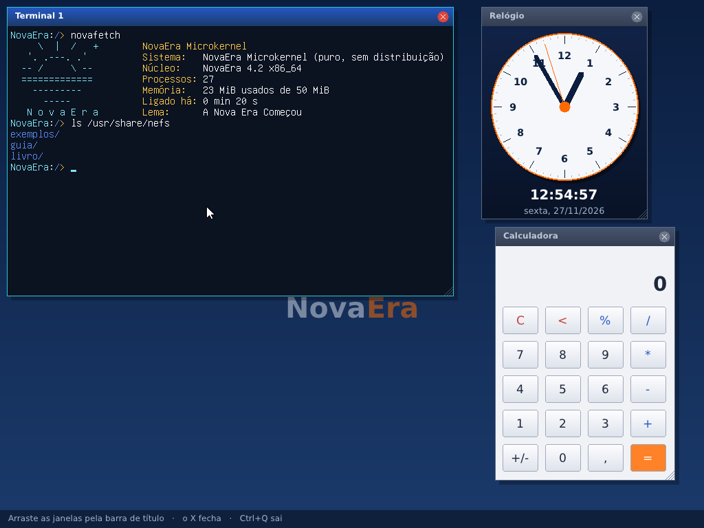

# 22. O terminal gráfico

Com janelas (capítulos 20 e 21), falta o mais importante: o **shell**
numa janela. E não só um: vários terminais abertos ao mesmo tempo, cada um
com o seu shell, como no Linux.



## Na prática

No modo gráfico (`bash run.sh vnc` no celular), rode:

```
janelas
```

Abre um **terminal** (com o shell de sempre dentro), o relógio e a
calculadora. Clique no terminal e digite os comandos normalmente: `ls`,
`novafetch`, `cproc`...

- **Mais terminais:** `janelas term term` abre dois. De dentro de um
  terminal, o comando `term` também abre outro (o primeiro fica esperando
  o segundo fechar: o shell ainda não tem o `&` para rodar algo "de
  fundo").
- **O Ctrl+C** só vale para o terminal da frente: dá para deixar um
  compilando e, no outro, rodar o `ps` e apertar Ctrl+C à vontade.
- **Fechar:** o X (o shell e o que ele estiver rodando terminam juntos), ou
  `sair` dentro do shell.
- **O tamanho:** puxe o canto, ou `term -c 60x20` (colunas x linhas).

## Um terminal é um servidor

Lembra do servidor de terminal (o PID 5)? Ele fica entre o teclado, a tela
e os programas: junta as teclas numa linha, mostra o eco, entrega a linha
no Enter e manda o SIGINT no Ctrl+C. Até aqui, ele atendia **um** terminal
só: o console.

Agora ele atende vários. Cada terminal é um **canal**:

| Canal | O que é |
|---|---|
| 0 | o console: as teclas vêm do teclado, o texto vai para o vídeo |
| 1 a 8 | os **terminais virtuais** (os "pty" do Unix) |

Cada terminal tem as suas coisas, separadas: a linha sendo digitada, o eco,
quem está em primeiro plano (para o Ctrl+C), o modo cru. É por isso que o
Ctrl+C de um não chega no outro.

Num terminal virtual, quem faz o papel do teclado e da tela é um
**programa**: o `term`. Ele pede um terminal novo ao servidor
(`TERM_PTY_CRIAR`) e põe o shell nele:

```
          teclas (TERM_PTY_TECLAS)
   term  ───────────────────────────►  servidor de   ◄──── MSG_LER ────  sh
 (janela) ◄───────────────────────────  terminal      ───── MSG_ESCREVER ─►
          o que o shell escreveu (TERM_PTY_LER)   (canal 3)
```

O shell **não sabe** que está numa janela: lê e escreve no canal dele como
sempre (a entrada e a saída padrão, que o filho herda). É o mesmo shell do
console, o mesmo `/bin/sh`.

## O caminho de uma tecla

1. O teclado manda a tecla ao servidor de terminal, para o **console**.
2. O console está no modo **cru** (o `janelas` pediu): a tecla vai na hora
   para o `janelas`, sem eco. Até o Ctrl+C vai como uma tecla comum.
3. O `janelas` manda a tecla para a janela da frente (`JN_TECLA`).
4. Se é um `term`, ele manda ao **seu** terminal virtual (`TERM_PTY_TECLAS`).
5. Lá, o servidor de terminal faz o de sempre: eco, a linha, o Enter... ou,
   se é o Ctrl+C, o SIGINT para quem está em primeiro plano **naquele**
   terminal.

E o caminho de volta: o shell escreve; o servidor guarda; o `term` lê,
desenha as letras (a fonte 8×16, com as mesmas cores do console) e avisa o
`janelas` que a janela mudou.

## As cores e o "limpar"

No console, cada pedaço de texto vai ao vídeo com a sua cor. Num terminal
virtual, tudo vira uma sequência de bytes só; a cor vai no meio, com um
código: o byte 27 (o "Esc"), o byte 1 e a cor. O `limpar` é o 27 e o 2. O
Linux faz parecido, com as sequências "ANSI" (`Esc [ 31 m` para vermelho).

## O fd 2 e o terminal certo

Um detalhe que apareceu: as mensagens de erro (o `stderr`, o fd 2) iam
sempre para o console, mesmo de um programa rodando num terminal
virtual. Agora cada programa sabe **qual é o seu terminal** (o canal da
entrada ou da saída padrão), e os erros, o eco das senhas e o Ctrl+C vão
para ele.

## Se o dono some

Se o `term` fechar sem avisar (ou falhar), o servidor de terminal percebe
na próxima vez que alguém pedir um terminal novo: um terminal cujo dono
morreu é liberado.
