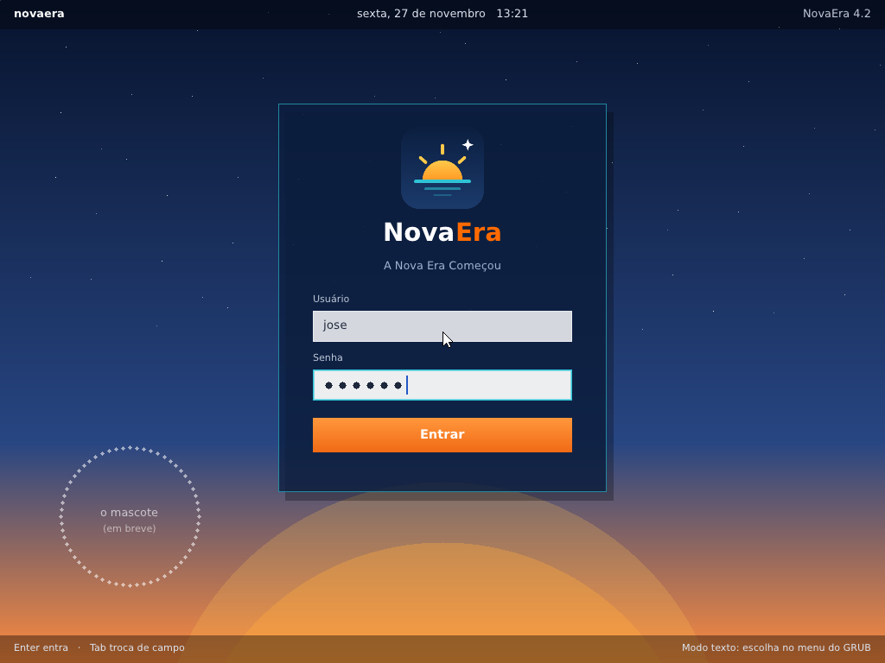

# 23. O modo gráfico no boot

Até aqui, o modo gráfico era um passeio: ligava-se no texto e digitava-se
`janelas`. Agora o NovaEra **instalado no disco** liga direto numa tela de
entrada gráfica, com a logo; quem entra cai numa sessão com um terminal
numa janela. O modo texto continua lá, para quem quiser.



## Na prática

Instale o NovaEra num disco (o Livro 2: `nefs guia`) e ligue por ele.
O menu do GRUB agora tem:

```
NovaEra (sda1)               <- o padrão: modo gráfico
NovaEra (sda1, modo texto)
```

No Termux, o disco instalado (o `disco.img`) liga assim:

```
bash run.sh disco vnc      # a tela de entrada gráfica, pelo app de VNC
bash run.sh disco          # dentro do Termux (curses): só texto, o login de texto
```

(O curses não mostra gráficos. Por isso o `run.sh disco` dá ao QEMU uma
placa de vídeo sem o modo gráfico, e o NovaEra percebe sozinho e usa o
login de texto.)

Na tela de entrada, digite o usuário, aperte Tab (ou Enter), a senha e
Enter, ou clique em **Entrar**. A sessão abre com um terminal, na sua pasta
pessoal (`/home/jose`, ou `/root` para o root). **Ctrl+Q** sai da sessão,
e a tela de entrada volta.

Num disco que já tinha o NovaEra, rode `instalar-boot` de novo para o GRUB
ganhar o menu novo (o `instalar-sistema` troca os programas e mantém os
usuários).

## Quem faz o quê no boot

```
núcleo -> shell do boot (PID 3) -> monta a raiz (root=sda1) -> /bin/init
          /bin/init -> monta os outros discos (/etc/montagens)
                    -> modo gráfico?  sim: /bin/login-grafico  (de novo, a cada saída)
                                      não: /bin/login          (o de texto)
```

O `init` decide pelo modo gráfico quando:

1. a linha de boot tem `grafico` (a opção padrão do GRUB, que liga a tela
   de 1024 × 768); e
2. o `/etc/modo` não diz `texto`.

Se o `login-grafico` não acha a tela gráfica (um PC sem a placa BGA, por
exemplo), ele avisa o `init` (sai com o código 3), e o `init` volta ao
login de texto. Ninguém fica sem conseguir entrar.

Para ligar sempre em modo texto, mesmo pela opção gráfica:

```
echo texto > /etc/modo
```

## A tela de entrada

O `login-grafico` desenha o papel de parede, a barra com o nome do
computador (`/etc/hostname`), a hora, a logo e o cartão com os campos. Ele
mesmo não sabe conferir senhas: pede ao **servidor de contas**, como o
login de texto (`CONTAS_CONFERIR`, depois `CONTAS_ENTRAR`).

Um detalhe do NovaEra decidiu o desenho: a **identidade** (quem é o usuário)
é de cada **thread**, não do programa inteiro. A tela de entrada tem
threads para o teclado, o mouse e o relógio; se a do teclado pedisse
"vire o jose", só ela viraria. Por isso, quem confere a senha e começa a
sessão é sempre a **thread principal**: as outras só mudam os campos e
acordam ela.

Com a senha certa:

1. a thread principal vira o usuário e vai para a pasta pessoal;
2. pede ao terminal para acordar a thread do teclado (`TERM_ACORDAR`),
   que estava esperando uma tecla, senão ela "roubaria" a primeira tecla
   da sessão;
3. devolve a tela sem apagar a imagem (`gr_tela_soltar`): a tela de
   entrada fica visível até as janelas abrirem, sem piscar o console;
4. começa `janelas --sessao term`, que já nasce como o usuário;
5. espera a sessão acabar e termina. O `init` mostra a entrada de novo.

## O papel de parede

O céu do amanhecer, com estrelas e o sol nascendo (como na logo), é
desenhado na hora (`usuario/papel.h`), pela tela de entrada e pelo
servidor de janelas. Para trocar por uma foto, ponha o caminho dela no
`/etc/papel`:

```
echo /home/jose/praia.jpg > /etc/papel
```

A foto é aumentada (ou diminuída) até cobrir a tela inteira, sem deformar.

## O lugar do mascote

No canto de baixo, um círculo pontilhado guarda o lugar do **mascote** do
NovaEra, que ainda vai nascer.
